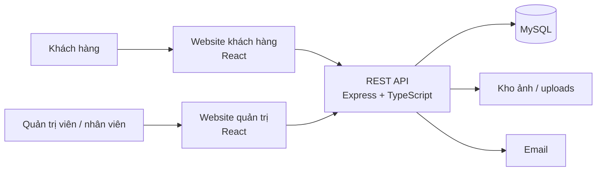
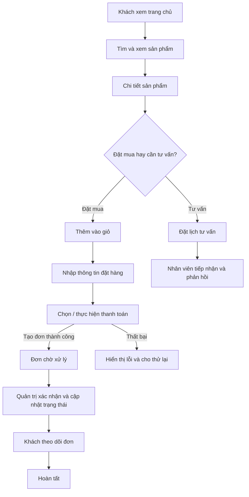
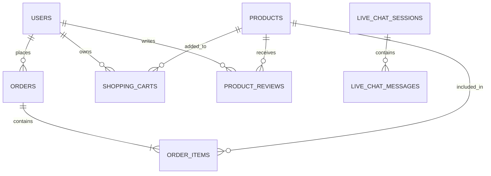

# Phác thảo hệ thống web Ngọc Thiện Wedding

> Bản phác thảo dựa trên cấu trúc mã nguồn hiện tại (React, Express/TypeScript, MySQL) và các trang/route đang có. Chưa đối chiếu được giao diện Figma: phiên Figma đã được mở nhưng công cụ không đọc được node `0:1` (báo chưa chọn layer), còn yêu cầu ảnh chụp bị timeout. Vì vậy, đây là bản đồ chức năng và luồng sản phẩm, chưa phải đặc tả pixel/UI từ Figma.

## 1. Mục tiêu sản phẩm

Một website bán sản phẩm và dịch vụ cưới, hỗ trợ khách khám phá sản phẩm, đặt lịch tư vấn, đặt hàng và theo dõi đơn; đồng thời cung cấp trang quản trị để nhân viên vận hành nội dung, sản phẩm, đơn hàng, khách hàng và tư vấn.

## 2. Sơ đồ tổng quan



Trong repo hiện tại, hai giao diện dùng chung ứng dụng React nhưng chạy theo cấu hình/host riêng (`start:user`, `start:admin`). Backend có các nhóm route xác thực, sản phẩm, giỏ, đơn hàng, tư vấn, chat, đánh giá và cấu hình trang chủ.

## 3. Phân hệ và sơ đồ trang

### Khách hàng

```text
Trang chủ
├── Danh sách sản phẩm
│   └── Chi tiết sản phẩm
├── Giỏ hàng
├── Đặt hàng → Thanh toán → Hóa đơn
├── Tài khoản
│   ├── Đăng nhập / Đăng ký
│   ├── Quên mật khẩu / Đặt lại mật khẩu
│   ├── Thông tin cá nhân
│   ├── Đơn hàng
│   └── Thông báo
├── Giới thiệu
├── Đặt lịch tư vấn
└── Chat hỗ trợ
```

### Quản trị

```text
Dashboard
├── Quản lý sản phẩm
├── Quản lý đơn hàng
├── Quản lý người dùng
├── Quản lý hình ảnh trang chủ
├── Lịch làm việc
├── Hoạt động / thông báo
└── Chat với khách hàng
```

Các màn hình này được suy ra từ route và component hiện có; một số tên route có thể khác với nhãn hiển thị trong giao diện.

## 4. Luồng nghiệp vụ cốt lõi



## 5. Vai trò và quyền hạn đề xuất

| Vai trò | Công việc chính |
| --- | --- |
| Khách | Xem sản phẩm, quản lý giỏ, đặt hàng, theo dõi đơn, gửi yêu cầu tư vấn, chat và đánh giá. |
| Nhân viên | Tiếp nhận yêu cầu, hỗ trợ chat, xử lý đơn và cập nhật trạng thái theo quyền được giao. |
| Quản trị viên | Quản lý sản phẩm, đơn, người dùng, hình ảnh trang chủ, lịch làm việc, thông báo và hoạt động. |

Backend hiện có middleware xác thực và kiểm tra quyền admin ở một số API. Nên thống nhất vai trò nhân viên/quản trị và quyền theo từng thao tác trước khi mở rộng quản trị nhiều cấp.

## 6. Nhóm dữ liệu chính

Theo model và schema hiện có: `users`, `products`, `shopping_carts`, `orders`, `order_items`, `product_reviews`, `consultations`, `live_chat_sessions`, `live_chat_messages`, `homepage_configs`.



## 7. Khung nội dung để đối chiếu Figma

Khi Figma đọc được, rà từng frame theo nhóm sau:

1. **Khách hàng:** trang chủ, danh sách/chi tiết sản phẩm, giỏ hàng, đặt hàng/thanh toán, đăng nhập/đăng ký, hồ sơ và đơn hàng.
2. **Tư vấn:** đặt lịch, trạng thái yêu cầu, hội thoại chat.
3. **Quản trị:** dashboard, sản phẩm, đơn hàng, người dùng, media trang chủ và chat.
4. **Thiết kế hệ thống:** màu, chữ, khoảng cách, nút, trường nhập, trạng thái tải/lỗi/rỗng và biến thể mobile.

Các quyết định còn cần xác nhận bằng thiết kế/luồng thực tế: khách có cần đăng nhập để đặt hàng không; phương thức thanh toán đang được vận hành; trạng thái đơn chính thức; lịch tư vấn có cần chọn chi nhánh/nhân viên; và quy trình đánh giá sau mua.

## 8. Ghi chú kết nối Figma

Đã khởi tạo phiên cho file `Ngọc Thiện Wedding` (key `yNfiA9kI96DptVgLtHCMYk`). Công cụ đọc thiết kế trả về “nothing selected” với node gốc `0:1`; công cụ screenshot cho node này hết thời gian chờ. Cần thử lại bằng URL trỏ trực tiếp tới một frame màn hình cụ thể (mở frame trong Figma rồi Copy link to selection), sau đó cập nhật tài liệu này bằng cấu trúc và style lấy từ thiết kế.
